# 🧠 SwarmMind — Auditable, Graph-Grounded Multi-Agent AI Collaboration

[](https://app.falkordb.cloud)
[](docs/TESTING.md)
[](docs/TESTING.md)
[](#)

> **An autonomous multi-agent intelligence collective where every thought, task handoff, disagreement, and memory is grounded in, coordinated through, and explained by FalkorDB.**
> Built for the **WeMakeDevs & FalkorDB Graph Hacks Hackathon** (Tracks: *Agent Memory & Coordination* and *Agents That Act on Connected Data*).

---

## ⚡ Quickstart in 60 Seconds (Zero Docker / Offline Mode)

SwarmMind runs completely out-of-the-box in local development mode without requiring Docker or cloud credentials.

### 1. Launch Backend (FastAPI + Python 3.12+ via `uv`)
```bash
cd backend
GRAPH_BACKEND=local uv run uvicorn app.main:app --reload --port 8000
```

### 2. Launch Frontend (React 18 + Vite + Tailwind CSS)
```bash
cd frontend
npm install
npm run dev
```

Visit **`http://localhost:5173`** to interact with the pre-seeded **VentureAudit** M&A due diligence investigation!

---

## ☁️ Connecting to FalkorDB Cloud (Production Engine)

When you are ready to evaluate against FalkorDB Cloud:

1. Create a free graph database at [FalkorDB Cloud](https://app.falkordb.cloud).
2. Configure `backend/.env`:
   ```dotenv
   GRAPH_BACKEND=falkordb
   FALKORDB_HOST=<your-instance-subdomain>.falkordb.cloud
   FALKORDB_PORT=6379
   FALKORDB_PASSWORD=<your-database-password>
   FALKORDB_SSL=true
   FALKORDB_GRAPH=swarmmind
   ```
3. Test connectivity and latency with the diagnostic script:
   ```bash
   cd backend
   uv run python scripts/test_cloud_connection.py
   ```
4. Seed the hackathon demo dataset into your cloud instance:
   ```bash
   cd backend
   uv run python scripts/seed_demo_data.py
   ```
5. Launch the backend (`uv run uvicorn app.main:app --reload`) and explore live in the browser!

*(Alternatively, run local Docker: `docker run --rm -p 6379:6379 -p 3000:3000 falkordb/falkordb:latest` with `FALKORDB_HOST=localhost` and `FALKORDB_SSL=false`)*

---

## 🗺️ Graph Map & Topology

> **Deliverable**: Visual mapping of all entity nodes, relationships, and the exact Cypher queries used by the agents.

### Complete Graph Schema Diagram

```mermaid
flowchart TD
    classDef project fill:#1e1b4b,stroke:#818cf8,stroke-width:2px,color:#fff;
    classDef run fill:#312e81,stroke:#a5b4fc,stroke-width:2px,color:#fff;
    classDef agent fill:#064e3b,stroke:#34d399,stroke-width:2px,color:#fff;
    classDef task fill:#14532d,stroke:#4ade80,stroke-width:2px,color:#fff;
    classDef turn fill:#4c1d95,stroke:#c084fc,stroke-width:2px,color:#fff;
    classDef claim fill:#701a75,stroke:#f472b6,stroke-width:2px,color:#fff;
    classDef source fill:#0f172a,stroke:#38bdf8,stroke-width:2px,color:#fff;
    classDef memory fill:#78350f,stroke:#fbbf24,stroke-width:2px,color:#fff;

    P["Project: ApexAI Audit ($45M)"]:::project
    R["Run: run-apexai-audit-eval"]:::run
    
    A1["Agent: M&A Lead Partner (Coord)"]:::agent
    A2["Agent: IP Forensics (Researcher)"]:::agent
    A3["Agent: Systems Analyst"]:::agent
    A4["Agent: Contradiction Critic"]:::agent
    A5["Agent: Deal Strategist (Planner)"]:::agent
    A6["Agent: Diligence Synthesizer"]:::agent

    T1["Task 1: Decompose Audit Scope"]:::task
    T2["Task 2: Audit SBOM vs Pitch"]:::task
    T3["Task 3: Cloud Telemetry Check"]:::task
    T4["Task 4: Cross-Examine Claims"]:::task
    T5["Task 5: Escrow Risk Matrix"]:::task
    T6["Task 6: Synthesize Report"]:::task

    S1["Source: Founder Pitch Deck"]:::source
    S2["Source: Git SBOM Audit"]:::source
    S3["Source: Delaware Court Docket"]:::source
    S4["Source: AWS Terraform State"]:::source

    C1["Claim: 100% Proprietary IP"]:::claim
    C2["Claim: GPLv3 Copyleft In Core"]:::claim
    C3["Claim: Undisclosed Injunction"]:::claim
    C4["Claim: Single-Region Deployment"]:::claim

    M1["Memory (Semantic): $12M Escrow Hold"]:::memory
    M2["Memory (Procedural): SBOM Cross-Ref"]:::memory
    M3["Memory (Episodic): Run Reflection"]:::memory

    Turn1["Turn 1 (User): Proceed with $45M Deal?"]:::turn
    Turn2["Turn 2 (Assistant): Hold $12M Escrow"]:::turn

    %% Structural Links
    P -->|HAS_RUN| R
    R -->|INCLUDES_AGENT| A1
    R -->|INCLUDES_AGENT| A2
    R -->|INCLUDES_AGENT| A4
    R -->|INCLUDES_AGENT| A6

    %% Task DAG & Handoffs
    R -->|HAS_TASK| T1
    R -->|HAS_TASK| T2
    R -->|HAS_TASK| T3
    R -->|HAS_TASK| T4
    R -->|HAS_TASK| T5
    R -->|HAS_TASK| T6
    T1 -->|DEPENDS_ON| T2
    T2 -->|HANDED_OFF_TO| T4
    T3 -->|HANDED_OFF_TO| T4
    T4 -->|HANDED_OFF_TO| T5
    T5 -->|HANDED_OFF_TO| T6

    %% Evidential Grounding
    S1 -->|SUPPORTS| C1
    S2 -->|SUPPORTS| C2
    S3 -->|SUPPORTS| C3
    S4 -->|SUPPORTS| C4

    %% The Critical Graph Dispute
    C1 -.->|CONTRADICTS| C2
    C1 -.->|CONTRADICTS| C4

    %% Cognitive Memories & Decisions
    R -->|RECORDED_EPISODE| M3
    P -->|ABOUT| M1
    P -->|ABOUT| M2
    M1 -->|INFORMED_BY| C2
    M1 -->|INFORMED_BY| C3

    %% Conversation History
    R -->|HAS_TURN| Turn1
    Turn1 -->|NEXT_TURN| Turn2
    Turn2 -->|MENTIONS| C1
    Turn2 -->|MENTIONS| C2
```



---

### Graph Entity Reference

| Label | Key Properties | Description |
|---|---|---|
| `Project` | `id`, `name`, `description`, `created_at` | Isolated collaborative workspace (multigraph isolated). |
| `Run` | `id`, `project_id`, `goal`, `status`, `started_at` | Lifecycle of an investigation run. |
| `Agent` | `id`, `role`, `name`, `status` | Specialized agent instance (`coordinator`, `critic`, etc.). |
| `Task` | `id`, `run_id`, `title`, `status`, `priority` | DAG unit of work assigned to an agent role. |
| `Claim` | `id`, `text`, `confidence`, `status` | Empirical proposition extracted from sources or agents. |
| `Source` | `id`, `title`, `uri`, `source_type` | Primary ground-truth evidence reference. |
| `Memory` | `id`, `content`, `memory_type`, `confidence`, `valid_at`, `invalid_at` | 3-tier persistent memory (Semantic, Episodic, Procedural). |
| `Turn` | `id`, `run_id`, `role`, `content`, `timestamp` | Graph-native ordered conversation turn linked list. |

---

### How SwarmMind Agents Query FalkorDB

Every step of the agent lifecycle is powered by parameterized OpenCypher queries:

#### 1. PageRank Claim Authority (Synthesizer Anchoring)
The `SynthesizerAgent` runs FalkorDB's native PageRank algorithm over empirical claims and support edges:
```cypher
CALL algo.pageRank('Claim', 'SUPPORTS') YIELD node, score
RETURN node.id AS claim_id, node.text AS text, score
ORDER BY score DESC LIMIT $limit
```

#### 2. Multi-Hop Shortest Path Explainability (`algo.SPpaths`)
When inspecting a decision or dispute, the engine traverses the exact path connecting opposing sources:
```cypher
MATCH (src {id: $start_id}), (dst {id: $end_id})
CALL algo.SPpaths({
  sourceNode: src,
  targetNode: dst,
  relTypes: ['SUPPORTS', 'CONTRADICTS', 'DERIVED_FROM', 'INFORMED_BY'],
  relDirection: 'both',
  pathCount: 1
}) YIELD path
RETURN [n IN nodes(path) | coalesce(n.title, n.text, n.summary, n.id)] AS explainable_path
```

#### 3. Dynamic Procedural Heuristic Reinforcement
When the `CriticAgent` detects contradictions or verified claims, it boosts or penalizes procedural rule nodes:
```cypher
MATCH (m:Memory {memory_type: 'procedural'})
WHERE ($project_id IS NULL OR m.project_id = $project_id)
SET m.confidence = CASE
    WHEN m.confidence + $delta > 1.0 THEN 1.0
    WHEN m.confidence + $delta < 0.0 THEN 0.0
    ELSE m.confidence + $delta
END,
m.successes = CASE WHEN $delta > 0 THEN coalesce(m.successes, 0) + 1 ELSE coalesce(m.successes, 0) END,
m.failures = CASE WHEN $delta < 0 THEN coalesce(m.failures, 0) + 1 ELSE coalesce(m.failures, 0) END,
m.updated_at = $updated_at
RETURN m
```

#### 4. Bi-Temporal Memory Invalidation & Superseding
When new empirical findings supersede obsolete assumptions:
```cypher
MATCH (old_m:Memory {id: $old_id}), (new_m:Memory {id: $new_id})
SET old_m.invalid_at = timestamp()
MERGE (new_m)-[r:SUPERSEDES]->(old_m)
RETURN r
```

#### 5. Graph-Native Conversation Linked List
Dialogue history is reconstructed without SQL joins:
```cypher
MATCH (r:Run {id: $run_id})-[:HAS_TURN]->(first:Turn)
WHERE NOT ()-[:NEXT_TURN]->(first)
MATCH path = (first)-[:NEXT_TURN*0..50]->(t:Turn)
OPTIONAL MATCH (t)-[:MENTIONS]->(c:Claim)
RETURN t, collect(DISTINCT c.id) AS mentioned_claim_ids
ORDER BY length(path) ASC
```

---

## 🛡️ Show the Graph Doing the Work

> **Deliverable**: Make it clear where your agent's decisions come from the graph, since FalkorDB needs to be central to your project.

In SwarmMind, **FalkorDB is not a passive database or sidecar logger — it is the agent's cognition layer**. The agents' internal prompts, execution dependencies, and strategic outputs are strictly derived from graph queries:

```
┌────────────────────────────────────────────────────────────────────────┐
│                        HOW THE GRAPH SHAPES ACTION                     │
├────────────────────────────────┬───────────────────────────────────────┤
│ Graph State in FalkorDB         │ Concrete Agent Decision & Behavior    │
├────────────────────────────────┼───────────────────────────────────────┤
│ 1. Task DAG & Dependencies     │ Coordinator schedules tasks based on  │
│    (:Task)-[:DEPENDS_ON]->... │ unresolved prerequisites and routes   │
│    (:Task)-[:HANDED_OFF_TO]-> │ execution context between agents.     │
├────────────────────────────────┼───────────────────────────────────────┤
│ 2. Procedural Heuristic Nodes  │ Before running, BaseAgent queries     │
│    (:Memory {confidence >=.55})│ FalkorDB for active rules and injects │
│                                │ them into the agent's system prompt.  │
├────────────────────────────────┼───────────────────────────────────────┤
│ 3. Explicit Contradiction Edge │ Critic detects conflict between deck  │
│    (Claim)-[:CONTRADICTS]->... │ & SBOM, writes CONTRADICTS edge, and  │
│                                │ penalizes rule confidence by -0.15.   │
├────────────────────────────────┼───────────────────────────────────────┤
│ 4. Native PageRank Centrality  │ Synthesizer executes algo.pageRank to │
│    CALL algo.pageRank(...)     │ select the top-evidenced claims to    │
│                                │ anchor the M&A Executive Summary.     │
├────────────────────────────────┼───────────────────────────────────────┤
│ 5. Shortest-Path Provenance    │ The UI and FastMCP tools trace every  │
│    CALL algo.SPpaths(...)      │ recommendation ($12M escrow) back to  │
│                                │ exact primary source documents.       │
└────────────────────────────────┴───────────────────────────────────────┘
```

### Direct Code Evidence: Prompt Conditioning from Graph
In `backend/app/agents/base.py`:
```python
# Dynamically inject learned procedural rules (confidence >= 0.55) and past episodic warnings
procedural_rules = await self.memory_service.get_procedural_rules(project_id, min_confidence=0.55, limit=5)
if procedural_rules:
    rules_block = "\n\n### Active Operational Heuristics (Learned from prior runs):\n"
    for rule in procedural_rules:
        rules_block += f"- {rule.instruction or rule.content} (confidence: {rule.confidence:.2f})\n"
    effective_prompt += rules_block
```

### Direct Code Evidence: PageRank Authority Anchoring
In `backend/app/agents/synthesizer.py`:
```python
# Query native PageRank centrality to weight anchoring findings for the executive summary
authority = await self.memory_service.repo.get_claim_authority(project_id, limit=5)
if authority:
    task_context["anchoring_findings_pagerank"] = [
        f"Claim: '{a.get('text')}' (PageRank Score: {a.get('score', 0):.4f})"
        for a in authority
    ]
```

---

## 🎥 Live Demo Walkthrough (Screen Recording & Pitch Script)

> **Deliverable**: Show your agent actually running from start to finish.

Follow this 3-minute walkthrough script to demonstrate the system end-to-end:

### Act 1: The Problem & Scenario (0:00 - 0:30)
- **Voiceover**: *"Traditional multi-agent systems communicate via flat chat strings. Critical facts get lost, contradictions get silently overwritten, and recommendations have zero provenance audit trail."*
- **Action**: Open `http://localhost:5173`. Show the clean, dark-mode SwarmMind dashboard.
- **Scenario**: Introduce **VentureAudit** — Autonomous Due Diligence on **ApexAI** for a simulated **$45M acquisition deal**.

### Act 2: Swarm Coordination & Task Execution (0:30 - 1:15)
- **Action**: In the **Workspace** tab, view the live execution feed and Task DAG.
- **Show**:
  - The 6 specialized agents (`Coordinator`, `Researcher`, `Analyst`, `Critic`, `Planner`, `Synthesizer`).
  - The dependency handoffs from Reconnaissance $\to$ SBOM Analysis $\to$ Infrastructure Inspection.
  - The live event stream showing token budgets and agent progress.

### Act 3: The Interactive Graph Explorer & Disputes (1:15 - 2:00)
- **Action**: Click the **Graph Explorer** tab.
- **Show**:
  - The full interactive React Flow graph showing nodes color-coded by label (`Project`, `Run`, `Agent`, `Task`, `Source`, `Claim`, `Memory`).
  - Toggle the **"Disputes Only"** filter switch.
  - Zoom in on the pulsing red **`[:CONTRADICTS]`** relationship connecting the Founder Pitch Deck claim (*"100% proprietary zero copyleft"*) and the Git SBOM audit (*"GPLv3 viral copyleft in core/routing_engine"*).
  - Click on the node to open the **Slide-Over Node Inspector** displaying metadata, confidence scores, and connected edges.

### Act 4: 3-Tier Cognitive Memory & Reinforcement (2:00 - 2:30)
- **Action**: Click the **Cognitive Memory** tab.
- **Show**:
  - **Semantic Tier**: View facts with bi-temporal timestamps (`valid_at`, `invalid_at`) and `[:SUPERSEDES]` lineage.
  - **Episodic Tier**: View run retrospective summaries (`(Run)-[:RECORDED_EPISODE]->(Memory)`).
  - **Procedural Tier**: View active heuristic rules (*"Cross-reference founder IP against SBOM"*). Highlight the dynamic confidence score ($0.68$) and explain how the Critic automatically boosts or penalizes rules in FalkorDB.

### Act 5: Multi-Hop Explainability & Executive Report (2:30 - 3:00)
- **Action**: Click the **Executive Report** tab.
- **Show**:
  - The synthesized Due Diligence Report recommending a **$12M deal escrow withholding**.
  - Click **"Explain Decision"** to open the **Multi-Hop Provenance Modal**.
  - Show the shortest path calculated via FalkorDB `algo.SPpaths` tracing from the Escrow Recommendation $\to$ Contradiction $\to$ Git SBOM $\to$ Delaware Injunction Docket.
  - Click **"Export Markdown"** or **"Export JSON"** for a one-click auditor handoff.

---

## 🎯 Automated Quality Benchmark & Verification

SwarmMind includes an automated evaluation suite (`app.evaluation.benchmark`):

```bash
cd backend
GRAPH_BACKEND=local uv run python -m app.evaluation.benchmark
```

```text
==================================================
        SWARMMIND QUALITY BENCHMARK REPORT        
==================================================
Project ID:               proj-apexai-audit
Claims Grounded:          4/4 (100.0%)
Contradiction Recall:     2/1 (100.0%)
Tasks Completed:          6/6 (100.0%)
Sources Integrated:       4
--------------------------------------------------
OVERALL EVALUATION GATE:  PASSED [100%]
==================================================
```

Run all 34 unit and integration tests:
```bash
cd backend
GRAPH_BACKEND=local uv run pytest tests/unit
```

---

## 🛠️ FastMCP Tool Server

SwarmMind provides a standalone FastMCP tool server (`backend/app/mcp_server.py`) exposing FalkorDB graph algorithms to external IDEs and agents (Claude Desktop, Cursor):
- `rank_evidence_authority(project_id, limit)`: Native PageRank claim ranking.
- `trace_shortest_path(project_id, claim_a_id, claim_b_id)`: Multi-hop explainability paths via `algo.SPpaths`.
- `get_disputes_with_evidence(project_id)`: Conflicting claims and citation pairs.
- `search_graph_memories(project_id, query)`: Semantic and procedural memory traversals.
- `record_claim_evidence(project_id, text, confidence, agent_role)`: Ingestion of empirical findings.

---

## 📚 Complete Documentation Suite

- 📖 [**Hackathon Submission Manifesto**](docs/HACKATHON_SUBMISSION.md) — Executive summary, judges guide, and track alignment.
- 📐 [**System Architecture**](docs/ARCHITECTURE.md) — Technical architecture, data flows, and state machines.
- 🕸️ [**Graph Schema & Cypher Queries**](docs/GRAPH_SCHEMA.md) — Entity nodes, relationships, and OpenCypher catalogue.
- 🔌 [**REST & SSE API Reference**](docs/API.md) — Complete endpoint documentation and FastMCP reference.
- 🤖 [**Agent Swarm & Prompts**](docs/AGENTS.md) — Role definitions, prompt injection matrix, and reinforcement loop.
- 🛡️ [**Security & Governance**](docs/SECURITY.md) — Multigraph isolation, secret redaction, and Cypher safety.
- 🧪 [**Testing & Quality Guide**](docs/TESTING.md) — Automated test suites and quality benchmark evaluation.

---

## 📄 License
MIT License. Built for the WeMakeDevs & FalkorDB Graph Hacks Hackathon.