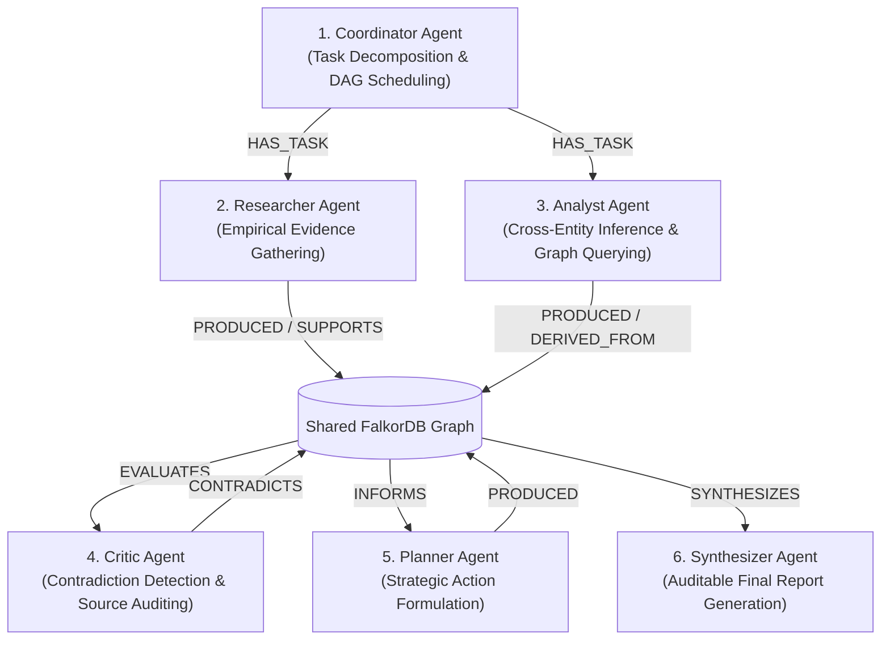

# SwarmMind Agent Architecture & Orchestration Specification

SwarmMind departs from unstructured agent chat logs by employing a **role-specialized, graph-grounded agent swarm**. Every agent reads from and writes to a shared FalkorDB knowledge graph with strict role boundaries, dependency-aware task scheduling, and structured typed outputs.

---

## 1. The 6 Specialized Agent Roles



### 1. Coordinator Agent (`coordinator`)
- **System Prompt**: `app/agents/prompts/coordinator.md`
- **Responsibilities**:
  - Breaks user goals into a Directed Acyclic Graph (DAG) of actionable subtasks.
  - Determines prerequisite dependencies (e.g., Critic cannot run until Researcher & Analyst complete).
  - Enforces execution step budgets (`MAX_AGENT_STEPS = 20`) and concurrency limits (`MAX_CONCURRENT_AGENTS = 3`).
- **Boundaries**: Cannot fabricate research findings or perform analysis directly.

### 2. Researcher Agent (`researcher`)
- **System Prompt**: `app/agents/prompts/researcher.md`
- **Responsibilities**:
  - Gathers empirical facts and statistical data from authorized external sources and datasets.
  - Registers `Source` nodes (`id`, `title`, `uri`, `source_type`) and `Claim` nodes.
  - Links claims to sources via `SUPPORTS` relationships.
- **Boundaries**: Cannot mark its own claims as independently verified; cannot query internal inference conclusions.

### 3. Analyst Agent (`analyst`)
- **System Prompt**: `app/agents/prompts/analyst.md`
- **Responsibilities**:
  - Traverses the shared knowledge graph for related findings.
  - Connects disparate evidence (e.g. inference unit costs vs pricing tiers) into synthesized interpretations.
  - Creates `Memory` nodes with `memory_type: 'insight'` and records `DERIVED_FROM` relationships.
- **Boundaries**: Must cite supporting memories; cannot invent unsourced assumptions.

### 4. Critic Agent (`critic`)
- **System Prompt**: `app/agents/prompts/critic.md`
- **Responsibilities**:
  - Audits claims against their underlying sources for logical leaps, ungrounded figures, or discrepancies.
  - Compares new claims against existing graph memory using Jaccard text overlap and numerical range comparison.
  - Flags conflicting claims by writing explicit `CONTRADICTS` relationships in FalkorDB with dispute notes and mitigation recommendations.
- **Boundaries**: **Never silently overwrites or deletes conflicting data**. Preserves disputes for human and synthesizer review.

### 5. Planner Agent (`planner`)
- **System Prompt**: `app/agents/prompts/planner.md`
- **Responsibilities**:
  - Formulates prioritized recommendations, milestones, and mitigation contingencies based on verified graph facts.
  - Links recommendations to supporting claims via `INFORMED_BY`.
- **Boundaries**: Explicitly flags assumptions and dependencies on disputed claims.

### 6. Synthesizer Agent (`synthesizer`)
- **System Prompt**: `app/agents/prompts/synthesizer.md`
- **Responsibilities**:
  - Aggregates the entire project knowledge graph into a cohesive, executive-ready report.
  - Surfaces primary source citations, unresolved disputes, confidence assessments, and operational risks.
- **Boundaries**: Must not invent citations or claim an investigation succeeded if tasks failed.

---

## 2. Tool Permissions Matrix

| Agent | Memory Search | Evidence Creation | Claim Creation | Contradiction Flagging | Task Management |
|---|:---:|:---:|:---:|:---:|:---:|
| **Coordinator** | Read | No | No | No | Full (Schedule/Assign) |
| **Researcher** | Read | Full (Create Source) | Full (Create Claim) | No | Self-update |
| **Analyst** | Full (Traverse) | Read | Full (Inferences) | No | Self-update |
| **Critic** | Full (Traverse) | Read | Read | Full (`CONTRADICTS`) | Self-update |
| **Planner** | Full (Traverse) | Read | Read | Read | Self-update |
| **Synthesizer**| Full (Traverse) | Read | Read | Read | Self-update |

---

## 3. Task State Machine & Resiliency

Each task in the DAG moves through deterministic states:
```text
[PENDING] ---> [SCHEDULED] ---> [RUNNING] ---> [COMPLETED]
                   |                |
                   v                v
              [CANCELLED]       [FAILED] ---> (Retry with Exponential Backoff)
```

- **Dependency Checking**: A task transitions to `SCHEDULED` only when all prerequisites in `task.dependencies` report `COMPLETED`.
- **Retry Policy**: Failed tasks are retried up to 3 times with exponential backoff (1s, 2s, 4s).
- **Graceful Cancellation**: Active runs can be cancelled at any time via `POST /api/runs/{id}/cancel`.
