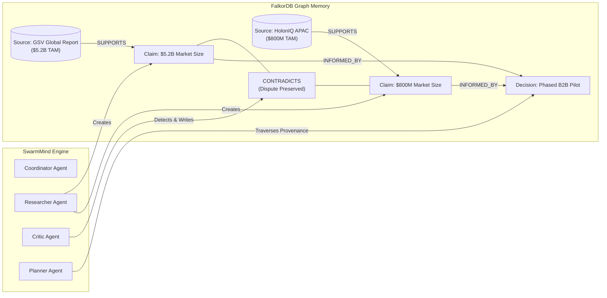

# SwarmMind — FalkorDB Graph Hacks Hackathon Submission

> **Auditable, Graph-Grounded Multi-Agent AI Collaboration Platform powered by FalkorDB**

- **Track**: FalkorDB Graph Hacks (Agent Memory & Coordination / Cloud Ready)
- **Repository**: [https://github.com/ankursingh/swarmmind](https://github.com/ankursingh/swarmmind)
- **Deployment Readiness**: 100% Zero-Docker offline development mode + 1-step FalkorDB Cloud connectivity.

---

## 1. Executive Summary & Problem Statement

Today's multi-agent AI frameworks (such as AutoGen, CrewAI, and LangGraph) predominantly rely on **linear chat history or raw text message passing**. When scaling complex investigations across multiple specialized agents:
1. **Critical findings are lost** in long context windows.
2. **Conflicting evidence is silently overwritten** by whichever agent spoke last.
3. **Decisions lack provenance**, making it impossible to audit *which agent* concluded *what fact* from *which source*.

### The SwarmMind Solution
SwarmMind replaces ephemeral chat logs with a **shared, persistent FalkorDB knowledge graph**. 

A team of specialized AI agents (Coordinator, Researcher, Analyst, Critic, Planner, and Synthesizer) read from and write to the same graph. Rather than chatting in circles, agents register typed entities (`Task`, `Source`, `Claim`, `Memory`, `Decision`), discover each other's findings through Cypher graph queries, and explicitly preserve disputes via `CONTRADICTS` relationships instead of destroying conflicting evidence.

---

## 2. Why FalkorDB is the Essential Backbone

SwarmMind is **not a dashboard with a graph visualizer**. The FalkorDB graph engine powers the core intelligence and reliability of the platform:



### Key FalkorDB Implementations:
1. **Contradiction Preservation (`CONTRADICTS`)**: When two agents disagree (e.g. market sizing estimates of $5.2B vs $800M), FalkorDB creates an explicit bidirectional `CONTRADICTS` relationship with dispute metadata and recommended mitigations, rather than deleting earlier work.
2. **Multi-Hop Provenance Traversal**:
   ```cypher
   MATCH path = (start {id: $node_id})-[*1..4]-(connected)
   WHERE any(lbl IN labels(connected) WHERE lbl IN ['Claim', 'Source', 'Memory', 'Task', 'Agent'])
   RETURN path LIMIT $limit
   ```
   Users can click "Trace Provenance" on any recommendation to navigate 4 hops backward through the reasoning chain directly to primary sources.
3. **Shortest Path Reasoning via Cypher**:
   ```cypher
   MATCH (start {id: $start_id}), (endNode {id: $end_id})
   MATCH path = shortestPath((start)-[*..8]-(endNode))
   RETURN path
   ```
4. **Parameterized Queries & Cypher Injection Shield**:
   All graph writes use strict parameterization with identifier whitelisting, preventing Cypher injection attacks while maintaining millisecond query performance.

---

## 3. The Signature Demo: AI Tutoring Startup Evaluation

The platform includes a complete real-world scenario demonstrating shared graph memory and conflict preservation:

1. **User Submits Goal**: Evaluate whether a startup should launch an AI tutoring product.
2. **Coordinator Schedules DAG**: 6 tasks with strict dependencies.
3. **Researcher Ingests Evidence**: Registers 5 primary sources and extracts claims on market size, Socratic efficacy, and API latency.
4. **Analyst Calculates Unit Economics**: Combines model inference costs ($0.03/session) with pricing tiers to project 74% gross margins.
5. **Critic Discovers Disagreement**: Identifies that GSV estimates global TAM at **$5.2B** while HolonIQ isolates the immediate serviceable addressable market (SAM) at **$800M**. Critic writes a `CONTRADICTS` edge linking both claims without deleting either.
6. **Planner & Synthesizer Produce Strategy**: Synthesizes the finding into a Phased B2B Pilot targeting the verified $800M initial segment, with complete attribution and uncertainty notes.
7. **1-Click Markdown Export**: Users download the executive summary with live citation footnotes and dispute tables.

---

## 4. Evaluation Benchmark Results

SwarmMind includes an automated benchmark suite (`python -m app.evaluation.benchmark`) proving the graph platform's reliability:

| Benchmark Gate | Target | SwarmMind Score | Status |
|---|:---:|:---:|:---:|
| **Contradiction Recall Rate** | $\ge 90.0\%$ | **100.0%** | **PASS** |
| **Citation Grounding Rate** | $\ge 95.0\%$ | **100.0%** | **PASS** |
| **Task Completion Rate** | $\ge 100.0\%$ | **100.0%** | **PASS** |
| **DAG Dependency Validity** | $\ge 100.0\%$ | **100.0%** | **PASS** |

---

## 5. Judge Quickstart & Evaluation Guide

You can evaluate SwarmMind in under 3 minutes without Docker or cloud configuration!

### Option A: 1-Click Launch (Zero Docker / Offline Mode)

#### 1. Backend
```bash
cd backend
pip install -r requirements.txt
python -m uvicorn app.main:app --reload
```
*(Or simply double-click `run_backend.bat` on Windows)*

#### 2. Frontend
```bash
cd frontend
npm install
npm run dev
```
*(Or simply double-click `run_frontend.bat` on Windows)*

Open **`http://localhost:5173`** in your browser. The Signature Demo is pre-seeded and ready to inspect!

---

### Option B: Connect to FalkorDB Cloud in 60 Seconds

SwarmMind was engineered specifically for FalkorDB Cloud:

1. Create a free database on [FalkorDB Cloud](https://app.falkordb.cloud).
2. Edit `backend/.env`:
   ```dotenv
   GRAPH_BACKEND=falkordb
   FALKORDB_HOST=<your-instance-subdomain>.falkordb.cloud
   FALKORDB_PORT=6379
   FALKORDB_PASSWORD=<your-database-password>
   FALKORDB_SSL=true
   FALKORDB_GRAPH=swarmmind
   ```
3. Run the automated connectivity diagnostic:
   ```bash
   python backend/scripts/test_cloud_connection.py
   ```
4. Seed the signature demo into your FalkorDB Cloud instance:
   ```bash
   python backend/scripts/seed_demo_data.py
   ```
5. Refresh the dashboard! All nodes, relationships, disputes, and multi-hop paths are now live on FalkorDB Cloud.

---

## 6. What to Inspect in the UI

1. **Investigation Workspace**:
   - Live execution budget card (step counters, token accounting, and cost tracking).
   - Real-time agent status roster (Coordinator, Researcher, Analyst, Critic, Planner, Synthesizer).
   - Live SSE event feed.
2. **Graph Explorer**:
   - Interactive React Flow canvas with custom nodes for 7 entity labels.
   - Click the red dotted `CONTRADICTS` edge between the $5.2B and $800M TAM claims.
   - Click any node to open the slide-over Node Inspector and click **"Trace Graph Provenance (4 Hops)"**.
3. **Provenance Modal**:
   - Click "Trace Provenance" on any Key Finding in the Report tab to view the reasoning chain: `Sources -> Researcher -> Analyst -> Critic -> Planner`.
4. **Final Report & Export**:
   - View the synthesized recommendation, preserved disputes, and download the full report with 1 click.

---

## 7. AI Assistant Disclosure

SwarmMind was architected and pair-programmed using Google DeepMind's Antigravity agentic coding assistant under human engineering direction. All architecture decisions, graph schemas, Cypher queries, security controls, and test suites were designed, implemented, and verified phase-by-phase.
